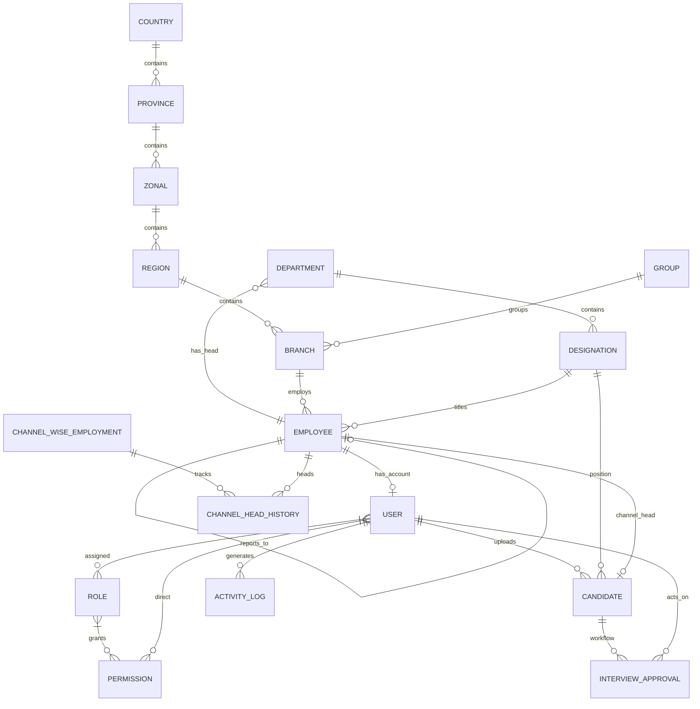
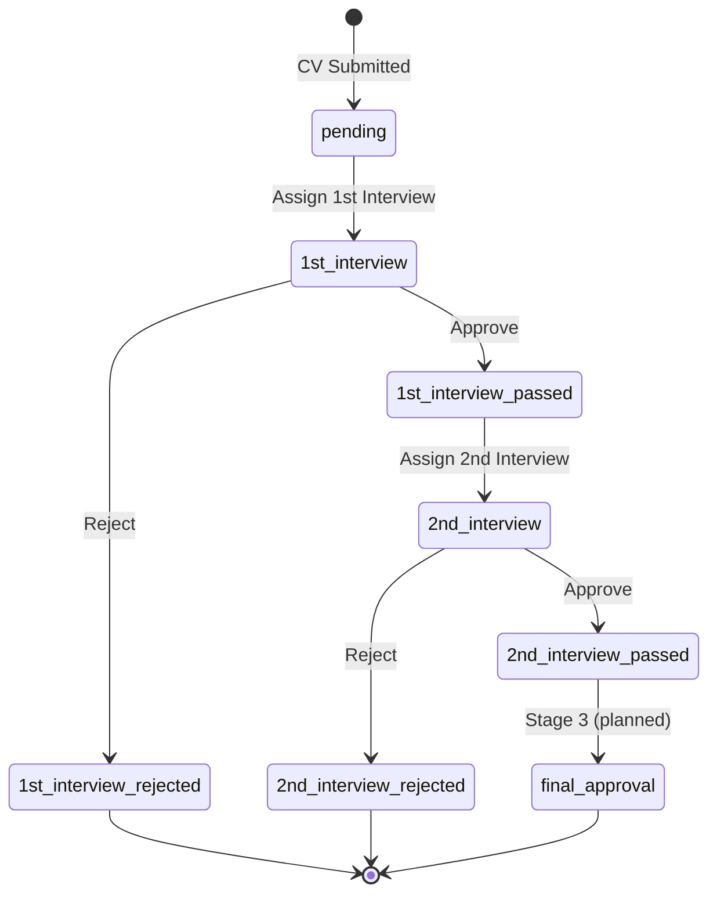
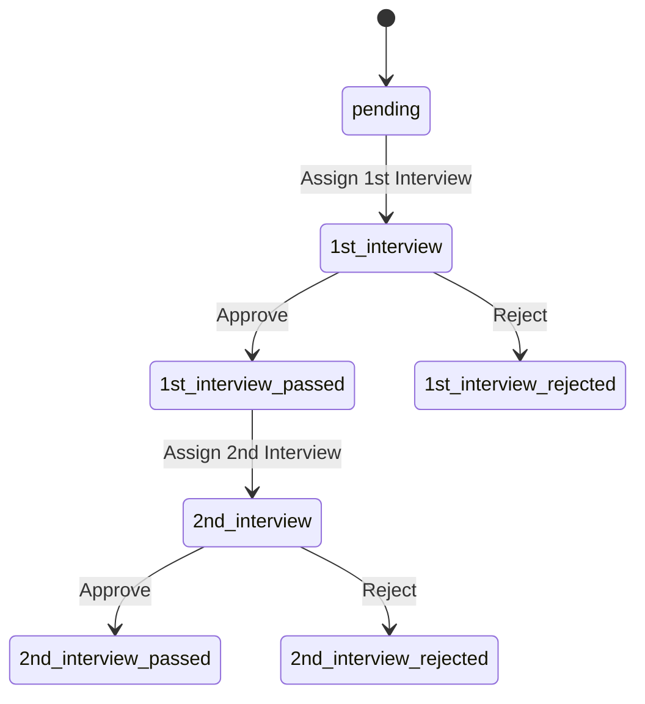

# CDP Onboarding API

> **Global Identity and Access Management & Candidate Onboarding Platform**

A high-performance, enterprise-grade REST API built on **Laravel 12** that serves as the central identity, access management, and candidate onboarding authority for the CDP ecosystem. Provides hierarchical organizational structure management, fine-grained RBAC via Spatie Permission, JWT authentication, and a multi-stage candidate interview pipeline.

---

## Table of Contents

- [Overview](#overview)
- [Tech Stack](#tech-stack)
- [System Architecture](#system-architecture)
  - [Entity Relationship Diagram](#entity-relationship-diagram)
  - [Data Model](#data-model)
- [Key Concepts](#key-concepts)
  - [Employee Hierarchy](#employee-hierarchy)
  - [Channel Resolution](#channel-resolution)
  - [Candidate Onboarding Pipeline](#candidate-onboarding-pipeline)
  - [RBAC Model](#rbac-model)
- [Directory Structure](#directory-structure)
- [API Reference](#api-reference)
  - [Health Checks](#health-checks)
  - [Authentication](#authentication)
  - [Permissions](#permissions)
  - [Roles](#roles)
  - [Users](#users)
  - [Countries](#countries)
  - [Provinces](#provinces)
  - [Zonals](#zonals)
  - [Regions](#regions)
  - [Branches](#branches)
  - [Departments](#departments)
  - [Designations](#designations)
  - [Groups](#groups)
  - [Channel-Wise Employments](#channel-wise-employments)
  - [Channel Heads](#channel-heads)
  - [Candidates](#candidates)
  - [Interview Workflow](#interview-workflow)
  - [Activity Logs](#activity-logs)
- [Request & Response Format](#request--response-format)
- [Authentication Flow](#authentication-flow)
- [Candidate Workflow](#candidate-workflow)
- [Installation & Setup](#installation--setup)
- [Testing](#testing)
- [Code Standards](#code-standards)
- [License](#license)

---

## Overview

The **CDP Onboarding API** (formerly CDP GIAM API) is the backbone of the CDP ecosystem. Instead of duplicating users, roles, and organizational data across multiple consumer applications, this platform provides a **single source of truth** for:

- **User authentication & authorization** — JWT-based with HttpOnly cookie fallback
- **Multi-application RBAC** — Roles and permissions managed via Spatie Laravel Permission
- **Organizational hierarchy** — Country > Province > Zone > Region > Branch, with Departments, Designations, and Groups
- **Employee management** — Self-referential reporting tree with recursive descendant queries
- **Channel management** — Employment channel classification with temporal head tracking
- **Candidate onboarding** — Multi-stage interview workflow with audit trail and hierarchical access control

---

## Tech Stack

| Layer | Technology | Version |
|-------|-----------|---------|
| **Framework** | Laravel | 12.0 |
| **PHP** | PHP | >= 8.2 |
| **Authentication** | JWT Auth (PHPOpenSourceSaver) | ^2.8 |
| **API Tokens** | Laravel Sanctum | ^4.0 |
| **RBAC** | Spatie Laravel Permission | ^6.23 |
| **OAuth** | Laravel Socialite | ^5.24 |
| **Testing** | Pest PHP | ^4.1 |
| **Code Style** | Laravel Pint | ^1.24 |
| **Frontend Build** | Vite | ^7.0 |
| **CSS** | Tailwind CSS | ^4.0 |
| **Database** | MySQL (primary), SQLite (testing) | — |
| **Cache/Queue** | Database (default), Redis (optional) | — |

---

## System Architecture

### Entity Relationship Diagram



### Data Model

The database is organized into five logical domains across **19 migration files**:

| Domain | Tables | Purpose |
|--------|--------|---------|
| **Geographic Hierarchy** | `countries`, `provinces`, `zonals`, `regions`, `branches` | 5-level territorial structure |
| **Organizational** | `groups`, `departments`, `designations`, `employees` | Corporate structure with reporting lines |
| **Auth & RBAC** | `users`, `permissions`, `roles`, `model_has_roles`, `role_has_permissions`, `model_has_permissions` | JWT auth + Spatie permission system |
| **Channel Management** | `channel_wise_employments`, `channel_head_histories` | Employment channels with temporal head tracking |
| **Recruitment** | `candidates`, `interview_approvals` | Multi-stage candidate onboarding pipeline |
| **Audit** | `activity_logs` | Full CRUD + workflow audit trail |
| **Infrastructure** | `cache`, `jobs`, `sessions`, `personal_access_tokens` | Laravel internals |

---

## Key Concepts

### Employee Hierarchy

Employees form a **self-referential tree** via `reporting_manager_id`. This tree powers:

- **Visibility scoping** — Users see candidates uploaded by themselves or their descendants
- **Channel resolution** — Walking up the reporting chain to find the channel head
- **Descendant queries** — `getAllDescendantUserIds()` recursively collects all indirect reports

```
CEO
├── VP Sales
│   ├── Regional Manager (North)
│   │   ├── Branch Manager A
│   │   └── Branch Manager B
│   └── Regional Manager (South)
│       └── Branch Manager C
└── VP Operations
    └── ...
```

### Channel Resolution

Each employee belongs to a **channel** (e.g.,不同的 business lines). Rather than assigning channels directly, the system walks up the `reporting_manager` chain until it finds a `ChannelHeadHistory` record. The channel head at that point in the chain determines the channel for all employees below them.

Channel heads are tracked with **SCD Type 2** (slowly changing dimension) using `effective_from` / `effective_to` dates, providing a complete temporal audit trail.

### Candidate Onboarding Pipeline

Candidates progress through a multi-stage interview workflow:



**Access Control:** A non-Super-Admin user can see candidates where:
1. They (or a descendant in their reporting manager hierarchy) uploaded the candidate
2. They are the channel head for the candidate's channel
3. They were assigned the candidate in an interview approval record
4. **Cross-channel 2nd Interview Access:** Once a candidate completes 1st interview (`1st_interview_passed`, `2nd_interview`, etc.), users holding 2nd interview permissions (`Candidate Assign 2nd Interview`, `Candidate Approve 2nd Interview`, `Candidate Reject 2nd Interview`) can view and action the candidate across all channels
5. **Cross-channel Final Approval Access:** Once a candidate completes 2nd interview (`2nd_interview_passed`, etc.), users holding Final Approval permissions (`Candidate Approve Final`, `Candidate Reject Final`) can view and action the candidate across all channels

### RBAC Model

Built on **Spatie Laravel Permission** with the `api` guard:

- **60+ granular permissions** across 11 groups (User, Role, Permission, Country, Province, Zonal, Region, Branch, Department, Designation, Group, Channel, Candidate, Activity Log)
- Permissions follow the pattern `{Entity} {Action}` (e.g., `Candidate Index`, `User Create`)
- Roles can be marked `is_protected` to prevent deletion
- Each controller defines its own permission requirements via the `HasMiddleware` interface

---

## Directory Structure

```
cdp-onboarding-api/
├── app/
│   ├── Http/
│   │   ├── Controllers/
│   │   │   ├── Controller.php              # Base controller
│   │   │   └── V1/                         # Versioned API controllers
│   │   │       ├── AuthController.php
│   │   │       ├── CandidateController.php
│   │   │       ├── UserController.php
│   │   │       ├── RoleController.php
│   │   │       ├── PermissionController.php
│   │   │       ├── BranchController.php
│   │   │       ├── CountryController.php
│   │   │       ├── ProvinceController.php
│   │   │       ├── ZonalController.php
│   │   │       ├── RegionController.php
│   │   │       ├── DepartmentController.php
│   │   │       ├── DesignationController.php
│   │   │       ├── GroupController.php
│   │   │       ├── ChannelWiseEmploymentController.php
│   │   │       ├── ChannelHeadController.php
│   │   │       └── ActivityLogController.php
│   │   └── Requests/                      # Form Request validation classes
│   │       ├── Create*Request.php          # Create operations
│   │       ├── Update*Request.php          # Update operations
│   │       ├── Assign*InterviewRequest.php # Interview assignment
│   │       ├── Approve*InterviewRequest.php# Interview approval
│   │       └── Reject*InterviewRequest.php # Interview rejection
│   ├── Mail/
│   │   └── UserCreateMail.php              # Welcome email for new users
│   ├── Models/                             # 17 Eloquent models
│   ├── Traits/
│   │   ├── ActivityLogTrait.php            # Audit logging with fallback
│   │   └── FileUploadTrait.php             # File upload/delete helpers

├── bootstrap/
│   └── app.php                             # Middleware registration, exception handling
├── config/
│   ├── auth.php                            # Default guard: api (JWT driver)
│   ├── jwt.php                             # JWT token configuration
│   ├── permission.php                      # Spatie Permission config
│   ├── cors.php                            # CORS settings
│   └── database.php                        # MySQL/SQLite/Redis connections
├── database/
│   ├── migrations/                         # 19 migration files
│   └── seeders/
│       ├── DatabaseSeeder.php
│       ├── PermissionsSeeder.php           # 60+ RBAC permissions
│       ├── UserSeeder.php                  # Default dev admin user
│       └── CdpEmpireSeeder.php             # Multi-application seed data
├── routes/
│   ├── api.php                             # Health check + v1 inclusion
│   ├── v1.php                              # All V1 API route definitions
│   └── web.php                             # Root info + health endpoint
├── api-docs/
│   ├── Public.postman_collection.json       # Public endpoints collection
│   └── Protected.postman_collection.json   # Protected endpoints collection
└── tests/
    ├── Feature/
    │   └── ChannelWiseEmploymentTest.php
    └── Unit/
        └── ExampleTest.php
```

---

## API Reference

All endpoints (except login and health checks) require a Bearer token:
```
Authorization: Bearer <jwt_token>
```

### Health Checks

| Method | Endpoint | Auth | Description |
|--------|----------|------|-------------|
| `GET` | `/` | Public | Application info JSON |
| `GET` | `/health` | Public | Health check with DB connectivity test |
| `GET` | `/api/health-check` | Public | Simple health check |

### Authentication

| Method | Endpoint | Permission | Description |
|--------|----------|------------|-------------|
| `POST` | `/api/v1/login` | Public | Login with `login` (username/email/id_number) + `password` |
| `POST` | `/api/v1/logout` | `auth:api` | Invalidate JWT token and clear auth cookie |
| `GET` | `/api/v1/me` | `auth:api` | Get authenticated user profile with roles & permissions |

### Permissions

| Method | Endpoint | Permission | Description |
|--------|----------|------------|-------------|
| `GET` | `/api/v1/permissions/list` | `auth:api` | Lightweight permission list (for dropdowns) |
| `GET` | `/api/v1/permissions` | `Permission Index` | Paginated permissions with search & filters |
| `POST` | `/api/v1/permissions` | `Permission Create` | Create new permission |
| `GET` | `/api/v1/permissions/{id}` | `Permission Index` | Get single permission |
| `PUT/PATCH` | `/api/v1/permissions/{id}` | `Permission Update` | Update permission (guard_name immutable) |
| `DELETE` | `/api/v1/permissions/{id}` | `Permission Delete` | Delete permission (blocked if assigned to roles) |

### Roles

| Method | Endpoint | Permission | Description |
|--------|----------|------------|-------------|
| `GET` | `/api/v1/roles/list` | `auth:api` | Lightweight role list (Super Admin sees all except self) |
| `GET` | `/api/v1/roles` | `Role Index` | Paginated roles with search |
| `POST` | `/api/v1/roles` | `Role Create` | Create role with permission IDs |
| `GET` | `/api/v1/roles/{id}` | `Role Index` | Get single role with permissions |
| `PUT/PATCH` | `/api/v1/roles/{id}` | `Role Update` | Update role, sync permissions |
| `DELETE` | `/api/v1/roles/{id}` | `Role Delete` | Delete role (blocked if protected or assigned) |

### Users

| Method | Endpoint | Permission | Description |
|--------|----------|------------|-------------|
| `GET` | `/api/v1/users` | `User Index` | List users (searchable, filterable by type/role/branch/status) |
| `POST` | `/api/v1/users` | `User Create` | Create user (admin/staff). Staff auto-creates Employee. Sends credential email. |
| `GET` | `/api/v1/users/{id}` | `User Index` | Get user with employee, geo-data, and roles |
| `PUT/PATCH` | `/api/v1/users/{id}` | `User Update` | Update user & employee details |
| `PATCH` | `/api/v1/users/{id}/toggle-status` | `User Toggle Status` | Toggle active/inactive (self-deactivation blocked) |
| `DELETE` | `/api/v1/users/{id}` | `User Delete` | Delete user (Super Admin only, self-deletion blocked) |

### Countries

| Method | Endpoint | Permission | Description |
|--------|----------|------------|-------------|
| `GET` | `/api/v1/countries/list` | `auth:api` | Active countries list |
| `GET` | `/api/v1/countries` | `Country Index` | Paginated countries with search |
| `POST` | `/api/v1/countries` | `Country Create` | Create country |
| `GET` | `/api/v1/countries/{id}` | `Country Index` | Get single country |
| `PUT/PATCH` | `/api/v1/countries/{id}` | `Country Update` | Update country |
| `PATCH` | `/api/v1/countries/{id}/toggle-status` | `Country Toggle Status` | Toggle active/inactive |
| `DELETE` | `/api/v1/countries/{id}` | `Country Delete` | Delete country |

### Provinces

| Method | Endpoint | Permission | Description |
|--------|----------|------------|-------------|
| `GET` | `/api/v1/provinces/list` | `auth:api` | Active provinces list (filterable by `country_id`) |
| `GET` | `/api/v1/provinces` | `Province Index` | Paginated provinces (filterable by `country_id`, `is_active`) |
| `POST` | `/api/v1/provinces` | `Province Create` | Create province under a country |
| `GET` | `/api/v1/provinces/{id}` | `Province Index` | Get single province with country |
| `PUT/PATCH` | `/api/v1/provinces/{id}` | `Province Update` | Update province |
| `PATCH` | `/api/v1/provinces/{id}/toggle-status` | `Province Toggle Status` | Toggle active/inactive |
| `DELETE` | `/api/v1/provinces/{id}` | `Province Delete` | Delete province |

### Zonals

| Method | Endpoint | Permission | Description |
|--------|----------|------------|-------------|
| `GET` | `/api/v1/zonals/list` | `auth:api` | Active zonals list (filterable by `province_id`) |
| `GET` | `/api/v1/zonals` | `Zonal Index` | Paginated zonals (filterable by `province_id`, `is_active`) |
| `POST` | `/api/v1/zonals` | `Zonal Create` | Create zonal under a province |
| `GET` | `/api/v1/zonals/{id}` | `Zonal Index` | Get single zonal with province & country |
| `PUT/PATCH` | `/api/v1/zonals/{id}` | `Zonal Update` | Update zonal |
| `PATCH` | `/api/v1/zonals/{id}/toggle-status` | `Zonal Toggle Status` | Toggle active/inactive |
| `DELETE` | `/api/v1/zonals/{id}` | `Zonal Delete` | Delete zonal |

### Regions

| Method | Endpoint | Permission | Description |
|--------|----------|------------|-------------|
| `GET` | `/api/v1/regions/list` | `auth:api` | Active regions list (filterable by `zonal_id`) |
| `GET` | `/api/v1/regions` | `Region Index` | Paginated regions (filterable by `zonal_id`, `is_active`) |
| `POST` | `/api/v1/regions` | `Region Create` | Create region under a zonal |
| `GET` | `/api/v1/regions/{id}` | `Region Index` | Get single region with full geo hierarchy |
| `PUT/PATCH` | `/api/v1/regions/{id}` | `Region Update` | Update region |
| `PATCH` | `/api/v1/regions/{id}/toggle-status` | `Region Toggle Status` | Toggle active/inactive |
| `DELETE` | `/api/v1/regions/{id}` | `Region Delete` | Delete region |

### Branches

| Method | Endpoint | Permission | Description |
|--------|----------|------------|-------------|
| `GET` | `/api/v1/branches/list` | `auth:api` | Active branches list (filterable by province/region/zone) |
| `GET` | `/api/v1/branches` | `Branch Index` | Paginated branches with filters |
| `POST` | `/api/v1/branches` | `Branch Create` | Create branch with address, geo coordinates, type |
| `GET` | `/api/v1/branches/{id}` | `Branch Index` | Get single branch with geo hierarchy |
| `PUT/PATCH` | `/api/v1/branches/{id}` | `Branch Update` | Update branch |
| `PATCH` | `/api/v1/branches/{id}/toggle-status` | `Branch Toggle Status` | Toggle active/inactive |
| `DELETE` | `/api/v1/branches/{id}` | `Branch Delete` | Delete branch (Super Admin only) |

### Departments

| Method | Endpoint | Permission | Description |
|--------|----------|------------|-------------|
| `GET` | `/api/v1/departments` | `Department Index` | Paginated departments with search |
| `POST` | `/api/v1/departments` | `Department Create` | Create department (head must be unique) |
| `GET` | `/api/v1/departments/{id}` | `Department Index` | Get department with head & designations |
| `PUT/PATCH` | `/api/v1/departments/{id}` | `Department Update` | Update department |
| `GET` | `/api/v1/departments/{id}/designations` | `Department Index` | Get designations under a department |
| `PATCH` | `/api/v1/departments/{id}/toggle-status` | `Department Toggle Status` | Toggle active/inactive |
| `DELETE` | `/api/v1/departments/{id}` | `Department Delete` | Delete department |

### Designations

| Method | Endpoint | Permission | Description |
|--------|----------|------------|-------------|
| `GET` | `/api/v1/designations/list` | `auth:api` | Active designations list (filterable by `department_id`) |
| `GET` | `/api/v1/designations` | `Designation Index` | Paginated designations (filterable by `department_id`, `is_active`) |
| `POST` | `/api/v1/designations` | `Designation Create` | Create designation with level & auto-calculated order_weight |
| `GET` | `/api/v1/designations/{id}` | `Designation Index` | Get single designation with department |
| `PUT/PATCH` | `/api/v1/designations/{id}` | `Designation Update` | Update designation (auto-resets order_weight on level change) |
| `PATCH` | `/api/v1/designations/{id}/toggle-status` | `Designation Toggle Status` | Toggle active/inactive |
| `DELETE` | `/api/v1/designations/{id}` | `Designation Delete` | Delete designation |

**Designation Levels:** `entry`, `mid`, `senior`, `lead`, `executive`, `Manager`, `Director`

### Groups

| Method | Endpoint | Permission | Description |
|--------|----------|------------|-------------|
| `GET` | `/api/v1/groups/list` | `auth:api` | Active groups list |
| `GET` | `/api/v1/groups` | `Group Index` | Paginated groups with search |
| `POST` | `/api/v1/groups` | `Group Create` | Create group |
| `GET` | `/api/v1/groups/{id}` | `Group Index` | Get single group |
| `PUT/PATCH` | `/api/v1/groups/{id}` | `Group Update` | Update group |
| `PATCH` | `/api/v1/groups/{id}/toggle-status` | `Group Toggle Status` | Toggle active/inactive |
| `DELETE` | `/api/v1/groups/{id}` | `Group Delete` | Delete group |

### Channel-Wise Employments

| Method | Endpoint | Permission | Description |
|--------|----------|------------|-------------|
| `GET` | `/api/v1/channel-wise-employments/list` | `auth:api` | Active channels list |
| `GET` | `/api/v1/channel-wise-employments` | `Channel Wise Employment Index` | Paginated channels with search |
| `POST` | `/api/v1/channel-wise-employments` | `Channel Wise Employment Create` | Create channel |
| `GET` | `/api/v1/channel-wise-employments/{id}` | `Channel Wise Employment Index` | Get single channel |
| `PUT/PATCH` | `/api/v1/channel-wise-employments/{id}` | `Channel Wise Employment Update` | Update channel |
| `PATCH` | `/api/v1/channel-wise-employments/{id}/toggle-status` | `Channel Wise Employment Toggle Status` | Toggle active/inactive |
| `DELETE` | `/api/v1/channel-wise-employments/{id}` | `Channel Wise Employment Delete` | Delete channel |

### Channel Heads

| Method | Endpoint | Permission | Description |
|--------|----------|------------|-------------|
| `GET` | `/api/v1/channel-wise-employments/{id}/head` | `Channel Wise Employment Index` | Get current active channel head |
| `POST` | `/api/v1/channel-wise-employments/{id}/head` | `Channel Wise Employment Update` | Assign new channel head (closes previous, opens new record) |
| `GET` | `/api/v1/channel-wise-employments/{id}/head/history` | `Channel Wise Employment Index` | Full paginated history of head assignments |

### Candidates

| Method | Endpoint | Permission | Description |
|--------|----------|------------|-------------|
| `GET` | `/api/v1/candidates/list` | `Candidate Index` | Lightweight candidate list (supports `status`, `stage` filters) |
| `GET` | `/api/v1/candidates/interviewers` | `Candidate Index` / Interview permission | List eligible active interviewers (`?stage=1st_interview\|2nd_interview\|final_approval`) |
| `GET` | `/api/v1/candidates` | `Candidate Index` | Paginated candidates with search, `status`, `stage`, designation filters (access-scoped) |
| `POST` | `/api/v1/candidates` | `Candidate Create` | Submit candidate CV (file upload, channel head snapshot) |
| `GET` | `/api/v1/candidates/{id}` | `Candidate Index` | Get candidate details (access-checked) |
| `PUT/PATCH` | `/api/v1/candidates/{id}` | `Candidate Update` | Update candidate profile, optionally replace CV |
| `GET` | `/api/v1/candidates/{id}/approvals` | `Candidate Index` | Get full interview approval audit trail |
| `DELETE` | `/api/v1/candidates/{id}` | `Candidate Delete` | Delete candidate and CV file |

### Interview Workflow

| Method | Endpoint | Permission | Description |
|--------|----------|------------|-------------|
| `POST` | `/api/v1/candidates/{id}/assign-1st-interview` | `Candidate Assign 1st Interview` | Assign 1st interviewer (`pending` / `1st_interview` -> `1st_interview`) |
| `POST` | `/api/v1/candidates/{id}/approve-1st-interview` | `Candidate Approve 1st Interview` | Approve 1st interview (`1st_interview` -> `1st_interview_passed`) |
| `POST` | `/api/v1/candidates/{id}/reject-1st-interview` | `Candidate Reject 1st Interview` | Reject 1st interview (`1st_interview` -> `1st_interview_rejected`) |
| `POST` | `/api/v1/candidates/{id}/assign-2nd-interview` | `Candidate Assign 2nd Interview` | Assign 2nd interviewer (`1st_interview_passed` -> `2nd_interview`) |
| `POST` | `/api/v1/candidates/{id}/approve-2nd-interview` | `Candidate Approve 2nd Interview` | Approve 2nd interview (`2nd_interview` -> `2nd_interview_passed`) |
| `POST` | `/api/v1/candidates/{id}/reject-2nd-interview` | `Candidate Reject 2nd Interview` | Reject 2nd interview (`2nd_interview` -> `2nd_interview_rejected`) |

### Employee Hierarchy

| Method | Endpoint | Permission | Description |
|--------|----------|------------|-------------|
| `GET` | `/api/v1/employees/{id}/manager-history` | `Employee Hierarchy View` | Get complete reporting manager history timeline |
| `POST` | `/api/v1/employees/{id}/reassign-manager` | `Employee Hierarchy Reassign` | Reassign reporting manager with effective date tracking |
| `GET` | `/api/v1/employees/{id}/hierarchy-as-of` | `Employee Hierarchy View` | Resolve point-in-time hierarchy for a specific date (`?as_of_date=Y-m-d`) |

### Activity Logs

| Method | Endpoint | Permission | Description |
|--------|----------|------------|-------------|
| `GET` | `/api/v1/activity-logs` | `Activity Log Index` | Paginated logs (filterable by module, action, user_id, level, date range) |
| `GET` | `/api/v1/activity-logs/{id}` | `Activity Log Index` | Get single log entry |

---

## Request & Response Format

### Success Response

```json
{
  "status": "success",
  "message": "User created successfully",
  "data": {
    "id": 1,
    "name": "John Doe",
    "username": "johndoe"
  }
}
```

### Validation Error Response (422)

```json
{
  "message": "Validation failed",
  "errors": [
    {
      "field": "email",
      "messages": ["The email field is required."]
    },
    {
      "field": "password",
      "messages": ["The password must be at least 8 characters."]
    }
  ]
}
```

### Error Response

```json
{
  "status": "error",
  "message": "Resource not found",
  "error": "No user found with ID 999"
}
```

---

## Authentication Flow

1. **Login** — `POST /api/v1/login` with `login` (username, email, or employee `id_number`) + `password`
2. **Token Issued** — JWT returned in both the JSON response body and an HttpOnly secure cookie (`auth_token`)
3. **Subsequent Requests** — Include `Authorization: Bearer <token>` header OR rely on the `auth_token` cookie
4. **Token Lifecycle** — Access token TTL: 60 minutes. Refresh TTL: 14 days.
5. **Logout** — `POST /api/v1/logout` invalidates the token and clears the cookie

### Guards

| Guard | Driver | Usage |
|-------|--------|-------|
| `api` (default) | JWT | All API endpoints |
| `web` | Session | Web routes (health checks) |

---

## Candidate Workflow

The candidate onboarding pipeline tracks applicants through a multi-stage interview process:



**Business Rules:**

| Current Status | Allowed Actions | Next Status |
|---------------|----------------|-------------|
| `pending` | Assign 1st Interview | `1st_interview` |
| `1st_interview` | Assign 1st Interview, Approve, Reject | `1st_interview` / `1st_interview_passed` / `1st_interview_rejected` |
| `1st_interview_passed` | Assign 2nd Interview | `2nd_interview` |
| `2nd_interview` | Assign 2nd Interview, Approve, Reject | `2nd_interview` / `2nd_interview_passed` / `2nd_interview_rejected` |

**Key Features:**
- **Channel Head Snapshotting** — When a candidate is submitted, the current channel head is recorded on the candidate for historical accuracy
- **Audit Trail** — Every assign/approve/reject action creates an `InterviewApproval` record with actor, date, and comments
- **Hierarchical Access** — Candidate visibility is scoped by reporting hierarchy, channel head assignment, or direct interview assignment

---

## Installation & Setup

### Prerequisites

- **PHP** >= 8.2
- **Composer** >= 2.x
- **MySQL** >= 5.7 (or MariaDB equivalent)
- **Node.js** >= 18.x (for Vite/frontend assets)
- Web server (Laragon, Nginx, Apache, or `php artisan serve`)

### 1. Clone & Install

```bash
git clone https://github.com/Insath97/cdp-onboarding-api.git
cd cdp-onboarding-api

composer install
npm install
```

### 2. Environment Configuration

```bash
cp .env.example .env
php artisan key:generate
```

Edit `.env` and configure:

```env
APP_NAME="VECTOR"
APP_URL=http://127.0.0.1:8000

DB_CONNECTION=mysql
DB_HOST=127.0.0.1
DB_PORT=3306
DB_DATABASE=cdp_vector_db
DB_USERNAME=root
DB_PASSWORD=

JWT_TTL=43200
JWT_REFRESH_TTL=43200
```

### 3. Generate JWT Secret

```bash
php artisan jwt:secret
```

### 4. Database Setup

```bash
php artisan migrate --seed
```

This seeds:
- **60+ RBAC permissions** across 11 groups
- **Super Admin** role with all permissions
- **Default admin user** (`devadmin` / `password`)

### 5. Start Development Server

```bash
php artisan serve
```

API available at: `http://127.0.0.1:8000`

### Default Credentials

| Field | Value |
|-------|-------|
| Username | `devadmin` |
| Email | `dev@localhost.com` |
| Password | `password` |
| Role | Super Admin |

---

## Testing

The project uses **Pest PHP** for testing with SQLite in-memory database.

```bash
# Run all tests
composer test

# Run with verbose output
./vendor/bin/pest -v

# Run a specific test file
./vendor/bin/pest tests/Feature/ChannelWiseEmploymentTest.php
```

### Test Configuration

- **Database:** SQLite in-memory (`:memory:`)
- **Mail:** Array driver (no emails sent)
- **Queue:** Sync (no background jobs)
- **Cache:** Array driver
- **Services disabled:** Pulse, Telescope, Nightwatch

---

## Code Standards

### Code Formatting

```bash
# Check code style
./vendor/bin/pint --test

# Fix code style
./vendor/bin/pint
```

### Architecture Patterns

| Pattern | Usage |
|---------|-------|
| **Form Requests** | All validation handled in dedicated Request classes |
| **API Resources** | Consistent JSON response format |
| **Traits** | `ActivityLogTrait` (audit), `FileUploadTrait` (file management) |
| **HasMiddleware** | Controller-level permission definitions |
| **Self-referential Models** | Employee reporting hierarchy |
| **Temporal Tables** | Channel head history with effective date ranges |

### Key Conventions

- All API routes are versioned under `/api/v1/`
- Controllers are organized by domain in `app/Http/Controllers/V1/`
- Form Request classes follow `Create{Entity}Request` / `Update{Entity}Request` naming
- Permission strings follow `{Entity} {Action}` format (e.g., `Candidate Index`)
- All controllers use `ActivityLogTrait` for audit logging
- Soft-deactivation via `toggle-status` endpoints (no hard deletes on master data)

---

## Postman Collections

Import the Postman collections from `api-docs/`:

- **`Public.postman_collection.json`** — Login endpoint
- **`Protected.postman_collection.json`** — All authenticated endpoints with example request bodies

---

## License

This project is open-source software licensed under the [MIT License](LICENSE).

Copyright (c) 2025 Mohamed Insath
